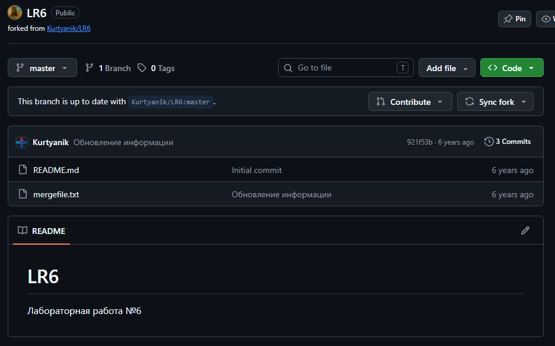
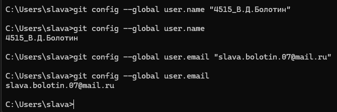
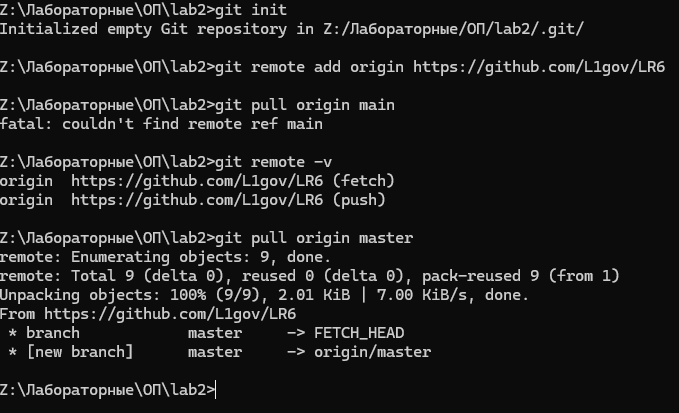
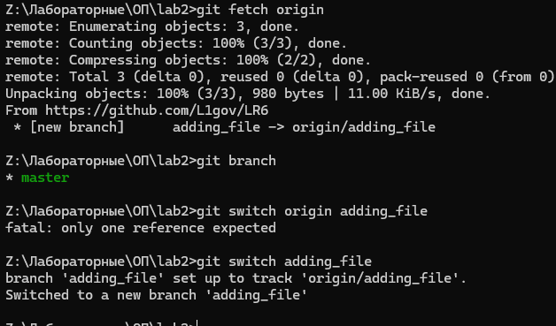
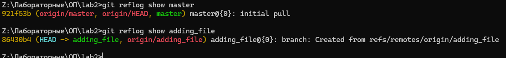
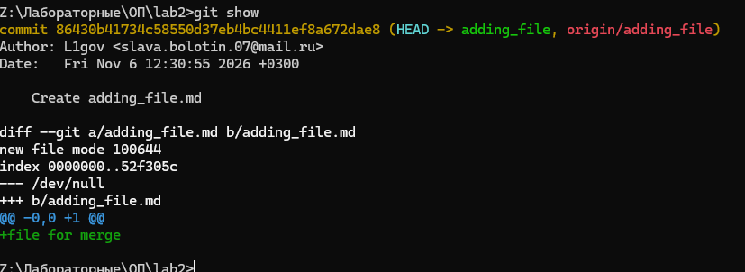
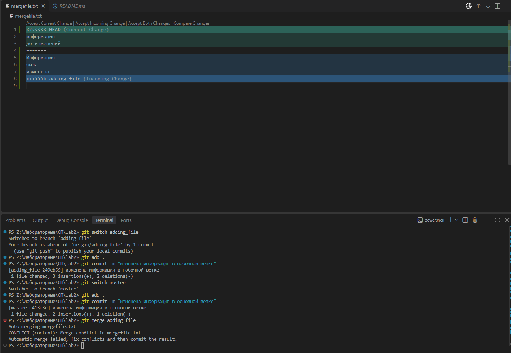
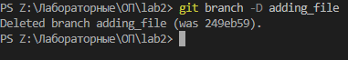
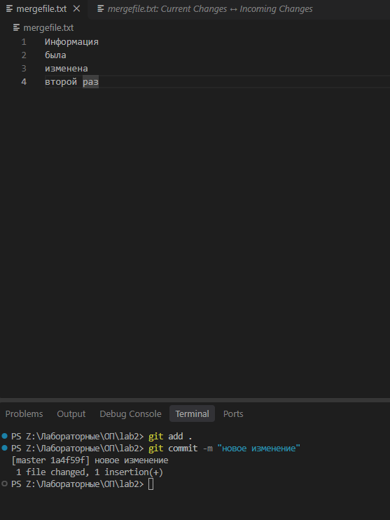
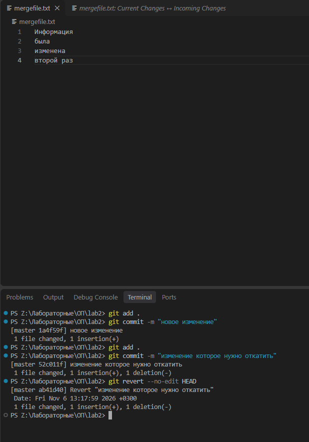

# Лабораторная работа №6 Работа с Git

**Выполнил:** Болотин В. Д., группа 4515  
**Дата:** 6 ноября 2026 года  
**Репозиторий:** [L1gov/LR6](https://github.com/L1gov/LR6)  
**Локальная папка:** `Z:\Лабораторные\ОП\lab2`  
**Ветка для отчёта:** `report`

## Цель работы

Освоить основные операции Git: настройку пользователя, получение удалённого репозитория, работу с ветками, просмотр истории и изменений, слияние с разрешением конфликта, удаление ветки и отмену коммита с сохранением истории.

## Использованные средства

- Git и терминалы Windows: командная строка и PowerShell.
- GitHub для создания копии репозитория и первоначальной работы с побочной веткой.
- Visual Studio Code для редактирования файлов и разрешения конфликта слияния.
- Markdown для оформления отчёта. Скриншоты размещены отдельно в папке `screenshots` и подключены относительными ссылками.

## Ход работы

### 1 Создание копии репозитория

На GitHub создана копия исходного репозитория `Kurtyanik/LR6` в аккаунте `L1gov`. Основная ветка репозитория называется `master`. В исходном состоянии в ней находились файлы `README.md` и `mergefile.txt`.

*Рисунок 1 — репозиторий LR6 на GitHub до начала локальной работы.*

### 2 Настройка пользователя Git

В глобальных настройках Git заданы имя автора `4515_В.Д.Болотин` и адрес электронной почты. Повторное чтение настроек подтвердило сохранение значений. Эти сведения используются при создании новых коммитов, если в репозитории не заданы локальные настройки автора.

*Рисунок 2 — запись и проверка глобальных настроек пользователя.*

### 3 Получение репозитория на локальный компьютер

В папке `lab2` инициализирован локальный репозиторий и добавлен удалённый репозиторий с именем `origin`. Первая попытка получить ветку `main` завершилась ошибкой, поскольку такой ветки в репозитории не было. После проверки адреса `origin` выполнено получение ветки `master`.

*Рисунок 3 — инициализация Git, добавление origin и получение основной ветки.*

### 4 Получение побочной ветки

На GitHub в ветке `adding_file` был создан файл `adding_file.md`. Команда `git fetch origin` загрузила сведения об этой ветке. Попытка переключения командой `git switch origin adding_file` содержала два отдельных аргумента вместо имени одной ветки и завершилась ошибкой.

После выполнения `git switch adding_file` Git создал локальную ветку `adding_file`, настроил отслеживание `origin/adding_file` и переключился на неё. Локально стали доступны две ветки: `master` и `adding_file`. Дальнейшие изменения выполнялись локально.

*Рисунок 4 — загрузка сведений о ветке и переключение на её локальную копию.*

### 5 История операций для каждой ветки

История локальных операций с ветками просмотрена командами `git reflog show master` и `git reflog show adding_file`. Для `master` зафиксировано первоначальное получение истории, а для `adding_file` — создание локальной ветки на основе удалённой.

*Рисунок 5 — просмотр reflog отдельно для каждой ветки.*

### 6 Просмотр последних изменений

Команда `git show` показала сведения о последнем на тот момент коммите `86430b4`, его авторе и изменениях файла. В коммите `Create adding_file.md` был добавлен файл `adding_file.md` со строкой `file for merge`.

*Рисунок 6 — просмотр коммита и внесённых им изменений.*

### 7 Слияние в master и разрешение конфликта

Первое слияние `adding_file` в `master` прошло в режиме fast-forward: на тот момент в основной ветке не было независимых коммитов, отсутствовавших в побочной ветке.

Для подготовки конфликта файл `mergefile.txt` затем изменён отдельно в обеих ветках. В `master` созданы коммиты `0a7f598` и `c413d3e`, а в `adding_file` — коммит `249eb59`. Ветки содержали разные изменения одного участка файла. При повторном выполнении `git merge adding_file` из ветки `master` возник конфликт содержимого.

В Visual Studio Code отображались вариант текущей ветки `master` и входящий вариант из `adding_file`. В итоговом файле сохранён входящий текст «Информация / была / изменена», а маркеры конфликта удалены. Исправленный файл добавлен в индекс, после чего создан коммит слияния `e1f66cf` с сообщением «подтянуты изменения из побочной ветки, решен конфликт».

*Рисунок 7 — конфликт содержимого mergefile.txt и интерфейс редактора для выбора итогового варианта.*

### 8 Удаление побочной ветки

После завершения слияния локальная ветка `adding_file` удалена. На снимке зафиксирована команда `git branch -D adding_file`. Флаг `-D` выполняет принудительное удаление локальной ветки. Коммит `249eb59` сохранился в истории `master`, поскольку вошёл в коммит слияния `e1f66cf`.

*Рисунок 8 — удаление локальной побочной ветки после слияния.*

### 9 Последовательное создание коммитов

В ветке `master` несколько раз изменён файл `mergefile.txt`. После каждого изменения файл сохранён, добавлен в индекс и зафиксирован отдельным коммитом с комментарием.

- Коммит `1a4f59f` с сообщением «новое изменение» добавил строку «второй раз».
- Коммит `52c011f` с сообщением «изменение которое нужно откатить» заменил её на «третий раз».

*Рисунок 9 — файл после изменения и фиксация результата в Git.*

### 10 Отмена последнего коммита

Для отмены изменений коммита `52c011f` выполнена команда `git revert --no-edit HEAD`. Создан новый коммит `ab41d40` с сообщением `Revert "изменение которое нужно откатить"`. Последняя строка файла вернулась к значению «второй раз».

Команда `revert` сохранила исходный коммит в истории и добавила отдельный коммит с обратными изменениями.

*Рисунок 10 — отмена последнего изменения с сохранением истории коммитов.*

### 11 Создание ветки для отчёта

После отмены коммита создана ветка `report` командой `git switch -c report`. Ветка создана от коммита `ab41d40`; при подготовке отчёта она являлась текущей. В ней размещены файл `report.md` и папка `screenshots` с иллюстрациями.

